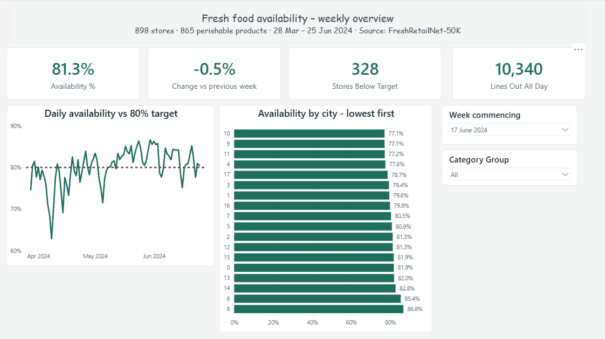
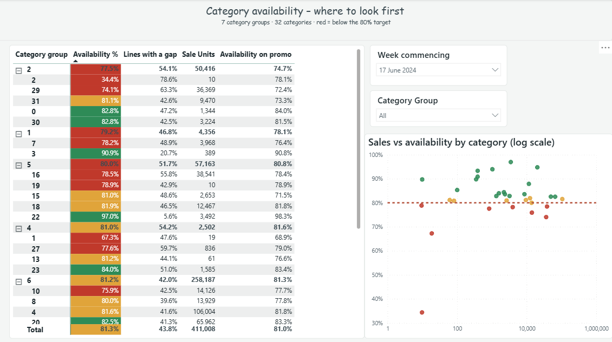
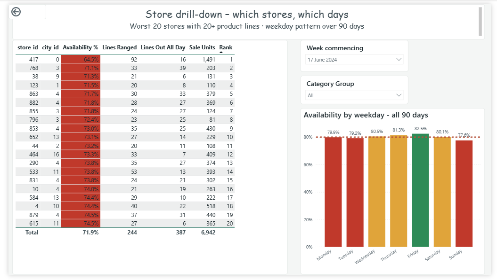

# Fresh Food Availability Reporting

Weekly availability reporting for a fresh grocery chain: 4.5 million store-product-day records loaded into
SQL Server, checked for data quality, modelled as a star schema and reported through SQL views, a Power BI
report and an Excel MI pack formatted by a VBA macro.

**Tools:** SQL Server (T-SQL), Python (pandas, pyodbc), Power BI (DAX), Excel VBA.



*Power BI overview page, filtered to the week commencing 17 June 2024. The cards and city bars follow the
week slicer; the daily line keeps the full 90 days for context.*



*Category page for the same week. Cells and dots are red below the 80% target, amber within 2 points above
it and green from 82%, using one DAX colour measure. The scatter puts sales on a log scale, so big sellers
below the line stand out.*



*Store drill-down page. The table ranks the 20 worst stores among those stocking 20 or more lines, so
one-product stores do not crowd the list. The weekday chart ignores the week slicer and shows all 90 days.
Right-clicking a city on the overview page drills through to this page for that city.*

## The question

Which stores, categories and lines are out of stock most often, and where should a replenishment team look
first each week?

## Data

[FreshRetailNet-50K](https://huggingface.co/datasets/Dingdong-Inc/FreshRetailNet-50K) by Dingdong-Inc
(CC BY 4.0). 898 stores in 18 cities, 865 perishable products, 50,000 store-product lines, 90 days
(28 Mar – 25 Jun 2024). Each row has the day's sales and the number of out-of-stock hours between 06:00
and 22:00. IDs are encoded and sales quantities are normalised by the publisher, so sales are shown as
units and never as money. The data has no waste or stock-on-hand figures.

## What it does

| Step | File | What happens |
|---|---|---|
| 1 | `sql/01_schema.sql` | Creates the star schema: `fact_daily_sales` with `dim_store`, `dim_product`, `dim_date` |
| 2 | `run_pipeline.py` | Loads the parquet file into SQL Server in 100,000-row batches |
| 3 | `sql/02_keys_and_indexes.sql` | Builds the date dimension, primary and foreign keys and a reporting index |
| 4 | `sql/03_data_quality_checks.sql` | Runs 9 checks and logs each result to `dq_results` |
| 5 | `sql/04_views.sql` | Reporting views: availability by store-day, city-week and category-week, a lost-sales estimate and the worst lines of the latest full week |
| 6 | `weekly_pack.py` | Exports the latest full week to an Excel workbook (4 sheets) |
| 7 | `vba/FormatWeeklyPack.bas` | Formats the workbook: titles, headers, number formats, filters, and highlights availability under 80% |
| 8 | `powerbi/fresh-food-availability-reporting.pbix` | Power BI report on the star schema (Import mode), built with `powerbi/measures.dax` and `powerbi/theme.json`; steps in `powerbi/BUILD_GUIDE.md` |

Availability is measured in hours: `1 - out-of-stock hours / (lines x 16 trading hours)`.

## Findings

- Overall availability was **80.1%** across the 90 days. 44% of store-product-days had at least one
  out-of-stock hour, and 4.0% (181,791) were out of stock for the whole trading day.
- Availability was lowest in the week of 8 April (73.4%) and highest in the week of 27 May (84.3%).
- Weekends were worse than weekdays: 78.8% against 80.7%.
- Lines on promotion had slightly lower availability (79.4%) than lines off promotion (80.5%).
- Cities ranged from 77.4% to 81.1%. Categories varied more: the weakest first-level category was at 72.2%.
- In the week commencing 17 June, availability was 81.3%, down 0.45 points on the week before (81.8%).
  328 of 898 stores were below the 80% target, and 10,340 store-product-days were out of stock all day.
- In the same week, 8 of 32 categories were below target, 7 were within 2 points above it and 17 were at
  82% or better. The 8 below target made up 22.8% of unit sales. The one to fix first is category 29:
  74.1% availability on 36,369 units, the largest seller below target.
- Ranking stores needs a size threshold. In that week the worst store overall, at 36.6%, stocked a single
  line. Among the 808 stores with 20 or more lines, the worst was store 417 at 64.5% across 92 lines. The 20
  worst of those averaged 71.9%, and 7 of them were in city 4.
- By weekday over the 90 days, Sunday was lowest (77.6%) and Friday highest (82.5%). Monday, Tuesday and
  Sunday were all below target.

## Data quality results

Six checks passed (no duplicates, no negative sales, no missing dates, complete 90-day series for every
line, out-of-stock hours within 0–16, no stores without sales). Three flagged rows:

| Check | Rows | Reading |
|---|---|---|
| Sales on a day flagged out of stock for all 16 hours | 33,746 | Probably sales outside 06:00–22:00, which the stock flag does not cover |
| Discount rate of zero or below | 16,039 | A zero rate would mean the product was free; treated as missing |
| Discount rate above 1 | 34 | Price above full price; likely a rounding or entry error |

The flagged rows are kept in the fact table and reported, not deleted.

## Limits

- The lost-sales view assumes sales are spread evenly across the trading day. It is a rough indication for
  ranking lines, not a forecast, so no total is quoted here.
- Encoded IDs mean results cannot be tied to named cities or products.

## Run it

Needs SQL Server (Express is enough), ODBC Driver 17 for SQL Server and Python 3.11+.

```
python -m venv .venv
.venv\Scripts\pip install -r requirements.txt
```

Download `data/train.parquet` (106 MB) from the dataset page into `data/`, then:

```
set SQLSERVER_INSTANCE=localhost\SQLEXPRESS
.venv\Scripts\python run_pipeline.py
.venv\Scripts\python weekly_pack.py
```

The load takes about 20 minutes on a laptop. Open the workbook in `output/`, import
`vba/FormatWeeklyPack.bas` (Alt+F11 > File > Import File) and run `FormatWeeklyPack`.

To refresh the Power BI report against your own SQL Server, open the `.pbix`, go to
Transform data > Data source settings and point it at your instance and the `FreshRetail` database.
